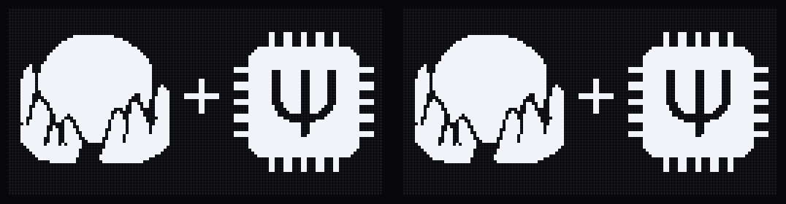
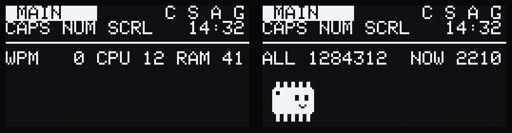
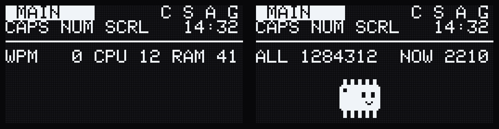
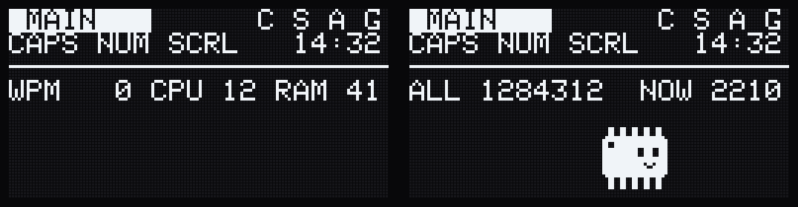
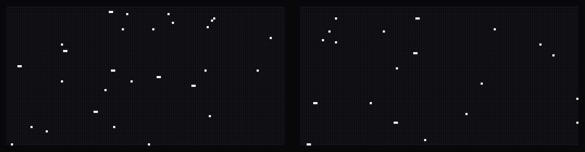
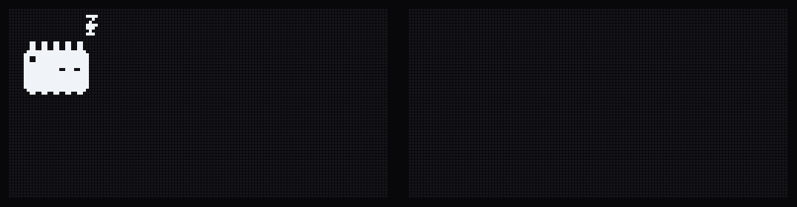
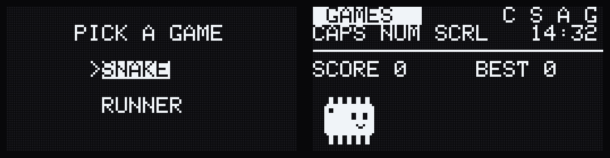

# Display gallery

What the two OLEDs show, left half on the left. The frames were rendered on
the PC from the firmware's own drawing code and QMK's font, with scripted key
presses. The time, CPU/RAM figures and keypress counts are made up, and the
games are played by simple bots. See the [main README](../README.md) for the
keys involved.

`tools/render_gifs.py` regenerates them; the scenes are scripted in
`tools/oledsim/sim.c`, which mirrors `display.c`.

## Boot

The logo (four seconds on the keyboard, shortened here), then the status screens.

## Typing

Typing speeds up to about 80 WPM and slows back down. The left graph fills
in, and the pet goes from standing to walking to running. It hops on every
Space, and the keypress counts go up.

## Pet reactions

**Ctrl held:** the C in the status strip lights up and the pet crouches and
creeps along. **Caps Lock on:** CAPS lights up and the pet panics until it's
off.

**Backspace:** a careful step back for each press; the fifth in a row brings
on a sweat drop.

**Swearing:** one of three reactions, picked at random. Here are all three
in turn: grawlix, soap and faint.

## Screensavers

Both screens act as one 256x64 field. **Saver** switches between the two
styles.

## Games

**Game** opens the menu on the USB half (normally the left). The other half
shows the score and best over the pet.

